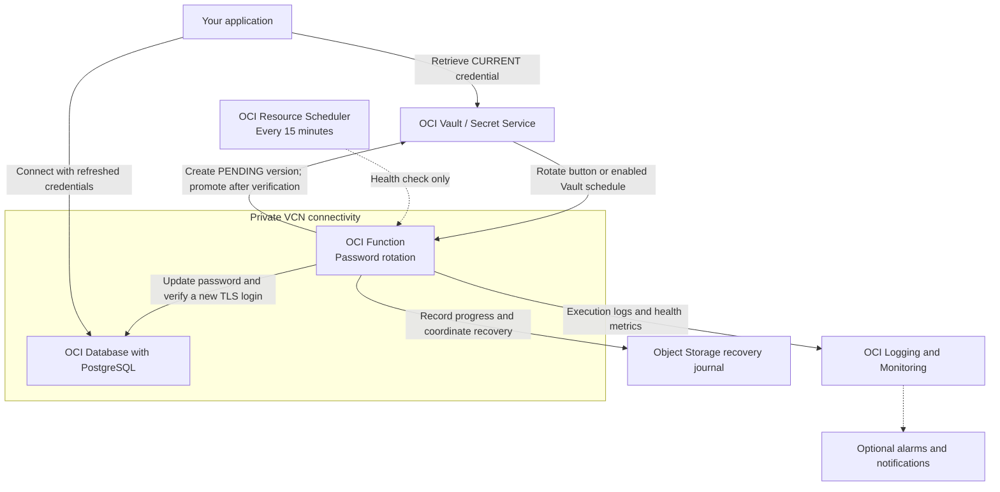

# PostgreSQL password rotation with OCI Vault

Keep an application’s PostgreSQL password and its OCI Vault secret in sync. Rotate credentials on demand or configure automatic rotation, and verify the new password before making it available to applications.

This package includes the rotation Function, infrastructure deployment, configuration tools, testing instructions and recovery procedures.

## What you can do

- Rotate an application database password through OCI Secret Service or the included CLI.
- Enable automatic rotation at your chosen interval after testing your application.
- Keep credentials in Vault and connect to PostgreSQL using verified TLS.
- Monitor rotation health and resume an interrupted rotation using its recorded progress.

Manual rotation through OCI Secret Service has been tested successfully: it updates the PostgreSQL password and Vault secret, then verifies a new database connection.

## Deployment architecture

The rotation Function connects to PostgreSQL over the private VCN. OCI Vault holds the credential versions, and your application retrieves the CURRENT version for new database connections.



For each rotation, the Function saves a pending credential in Vault, updates the database password, and tests a new connection. Only after that check succeeds does it make the new Vault version CURRENT. The application must refresh its cached credentials for new connections.

The Function uses an OCI resource principal with IAM policies scoped to the selected secret and recovery journal. Database connections use verified TLS and require the private network access described in the [deployment guide](DEPLOYMENT.md).

**Two schedules serve different purposes:** OCI Vault controls automatic password rotation, enabled after testing. The deployed 15-minute Resource Scheduler job checks rotation health and does not change passwords. See [architecture details](docs/architecture.md) for recovery and operational considerations.

## What deployment creates

| Component | What it does | Deployment behavior |
|---|---|---|
| OCI Function and application | Update the database password, verify it and update the Vault secret | Created from the image you build and publish |
| Monitoring schedule | Invoke the Function every 15 minutes to report rotation health | Created and enabled; these checks do not change passwords |
| IAM policies and dynamic groups | Allow the Function to access the selected secret and recovery journal | Created |
| Private, versioned journal bucket | Record progress so interrupted rotations can be resumed | Created by default; an existing bucket can be used |
| Invocation logs | Help operators track execution and investigate failures | Created and enabled |
| Monitoring alarms | Report failures, overdue rotation and missing monitoring activity | Created when you provide a Notifications topic |
| Automatic password-rotation schedule | Have OCI Vault invoke the Function at the configured interval | Enabled separately after validation with `schedule --confirm` |

Use an existing PostgreSQL database, application role, credential secret and suitable private subnet. Follow the deployment guide to build the container image, configure database access and supply the trusted CA certificate.

## Where to run the setup

**Recommended: use an OCI Compute VM with private network access to PostgreSQL as your deployment host.** SSH to that VM and run installation, configuration, image build/push, Terraform deployment and live CLI tests from the cloned repository. The VM needs the tools and OCI permissions listed in the [deployment guide](DEPLOYMENT.md#choose-your-deployment-host).

A laptop also works when it has the required tools, OCI credentials and database connectivity through a VPN or SSH tunnel. Terraform runs on whichever deployment host you choose. After deployment, OCI Functions performs rotations and OCI manages the schedules; the deployment host does not need to stay running. Preserve its Terraform state and configuration for future updates.

See the [task and execution-location table](DEPLOYMENT.md#tasks-and-where-to-run-them) for the complete workflow, including downloading the database CA certificate and testing the rotated password.

## Get started

1. Follow [Deployment](DEPLOYMENT.md) to install the tools, configure your target, build the image and deploy the resources.
2. Follow [Testing](TESTING.md) to verify manual rotation and confirm your application refreshes credentials for new connections.
3. Set `function_id` from the deployment output and choose `rotation_days` in your configuration. Enable automatic password rotation when ready:

```bash
pg-vault-rotation --config rotation.function.yaml schedule --confirm
pg-vault-rotation --config rotation.function.yaml status
```

To stop automatic password rotation:

```bash
pg-vault-rotation --config rotation.function.yaml unschedule --confirm
```

Disabling password rotation leaves the monitoring schedule running. For on-demand use, see [Console rotation](docs/console-rotation.md).

## Before production use

This release supports one application login role. Managed-administrator rotation and alternating-user rotation are not supported. Applications must refresh their cached Vault credentials for new connections; existing database sessions can remain open.

This is a prerelease. Validate scheduled execution, application connection-pool behavior, notifications and recovery in your environment. Review the outstanding container security findings in [SECURITY.md](SECURITY.md) before production deployment.

## Documentation

- [Deployment instructions](DEPLOYMENT.md)
- [Testing and acceptance](TESTING.md)
- [Console rotation](docs/console-rotation.md)
- [Operations](docs/operations.md) and [recovery](docs/recovery-runbook.md)
- [Validation results](docs/validation.md) and [customer handoff](docs/customer-handoff.md)
- [Architecture](docs/architecture.md) and [change history](CHANGELOG.md)

The customer operates this custom integration in their tenancy; it carries no separate Oracle product SLA.
